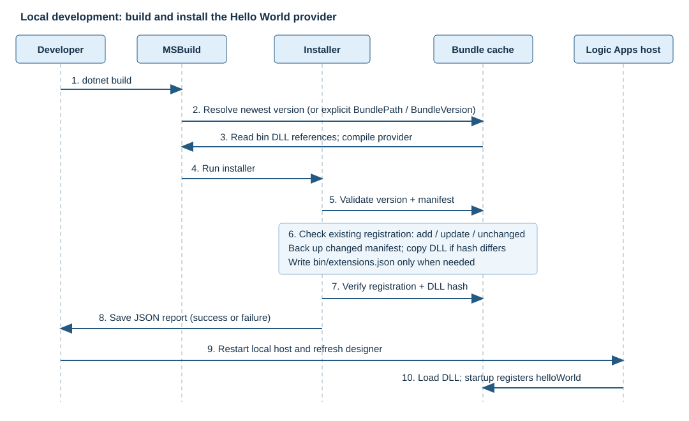
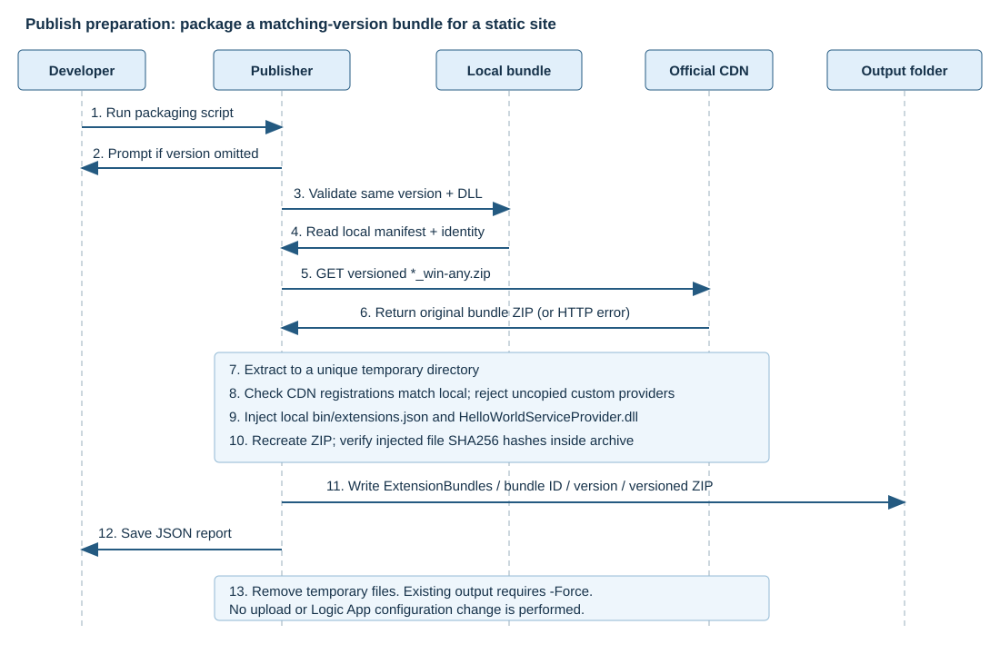

# Hello World service provider for Azure Logic Apps Standard

A sample **custom built-in connector** for single-tenant Azure Logic Apps (Standard).
It exposes one **Say hello** action and demonstrates two development tasks:

1. Build the provider and install it into an installed local workflow extension bundle.
2. Download a matching official bundle, inject the locally installed registration and DLL,
   and produce a ZIP in the directory layout needed for static-site hosting.

> This is a development sample. Modifying the Functions extension-bundle cache is
> machine-local, shared by projects using that version, and can be undone by a bundle
> download/update. The packaging script creates files locally; it does **not** upload
> anything, publish a Logic App, or configure a remote host to use the custom bundle.
> The generated ZIP is Windows-specific (`win-any`).

## What is a service provider?

A service provider implements a built-in connector inside the Logic Apps Standard
runtime. Unlike a managed connector, its operations run within the workflow host
rather than through a separately hosted managed connector service. A provider describes
its connector and operations to the designer, supplies input/output schemas, and
executes operations when workflows call it. It can call external services, but this
sample only creates a greeting and requires no connection credentials.

This extensibility model builds on Azure Functions/WebJobs extensions:

| File | Responsibility |
| --- | --- |
| [HelloWorldServiceOperationProvider.cs](HelloWorldServiceOperationProvider.cs) | Implements `IServiceOperationsProvider`; defines connector metadata, the action manifest, and execution. |
| [HelloWorldStartup.cs](HelloWorldStartup.cs) | Implements `IWebJobsStartup`; registers the extension and provider in dependency injection. |
| [HelloWorldExtensionConfigProvider.cs](HelloWorldExtensionConfigProvider.cs) | Registers the `helloWorld` service with `ServiceOperationsProvider`. |
| [HelloWorldServiceProvider.csproj](HelloWorldServiceProvider.csproj) | Resolves bundle references, builds the .NET 8 DLL, and runs local installation after a successful build. |
| [Resolve-WorkflowBundlePath.ps1](Resolve-WorkflowBundlePath.ps1) | Resolves an explicit bundle path/version or the numerically newest installed version. |
| [WorkflowBundleTools.ps1](WorkflowBundleTools.ps1) | Shared bundle-path, manifest-schema, duplicate-registration, SHA256, portable ZIP, and JSON-report helpers. |
| [Install-WorkflowBundleExtension.ps1](Install-WorkflowBundleExtension.ps1) | Installs the provider DLL and an idempotent startup registration. |
| [Publish-WorkflowBundle.ps1](Publish-WorkflowBundle.ps1) | Downloads, customizes, verifies, and packages a matching Windows bundle for hosting. |

The connector ID is `/serviceProviders/helloWorld`, its name is `helloWorld`, and its
operation ID is `helloWorld`. With `name: "Ada"`, the action returns
`{"message":"Hello, Ada!"}` in its response body. An omitted name defaults to `World`.

See Microsoft's [custom built-in connector documentation](https://learn.microsoft.com/en-us/azure/logic-apps/create-custom-built-in-connector-standard)
and [service provider interface overview](https://learn.microsoft.com/en-us/azure/logic-apps/custom-connector-overview#service-provider-interface-implementation).

## Prerequisites

- Windows, a .NET SDK supporting `net8.0`, and Windows PowerShell 5.1 or PowerShell 7.
- VS Code with the Azure Logic Apps (Standard) extension and its local-development prerequisites.
- An installed workflow extension bundle. Start the local Logic Apps host once so it
  downloads the configured bundle, then stop it before modifying bundle files.
- HTTPS access to `functionscdn.azureedge.net` for packaging.

The normal local cache is:

```text
%USERPROFILE%\.azure-functions-core-tools\Functions\ExtensionBundles\
  Microsoft.Azure.Functions.ExtensionBundle.Workflows\
    1.170.91\
      bin\
        extensions.json
        Microsoft.Azure.Workflows.ServiceProviders.Abstractions.dll
        ...
```

The actual registration file is **`extensions.json` (plural)**, not `extension.json`.

## 1. Build and install locally



Run these commands from this project directory. Stop any local Logic Apps host using
the bundle first to avoid DLL locks.

### Select the bundle

The project uses **`BundlePath`**, pointing to the **version directory**, not `bin`.
If neither a path nor a version is supplied, every build resolves the numerically
newest installed version in `BundleRootPath`. For example, `1.170.91` sorts after
`1.170.43`, and `1.10.0` sorts after `1.9.0`.

```powershell
# Automatically use the newest installed workflow bundle.
dotnet build .\HelloWorldServiceProvider.csproj

# Pin an installed version for a reproducible build.
dotnet build .\HelloWorldServiceProvider.csproj -p:BundleVersion=1.170.91

# Or supply a full version directory (not its bin subdirectory).
$bundle = "$env:USERPROFILE\.azure-functions-core-tools\Functions\ExtensionBundles\Microsoft.Azure.Functions.ExtensionBundle.Workflows\1.170.91"
dotnet build .\HelloWorldServiceProvider.csproj "-p:BundlePath=$bundle"

# Compile only, without changing the local bundle.
dotnet build .\HelloWorldServiceProvider.csproj -p:BundleVersion=1.170.91 -p:InstallWorkflowBundleExtension=false
```

For a different cache location, pass `"-p:BundleRootPath=C:\MyBundleCache"`.
You can also set `BundlePath` or `BundleVersion` in the project's property group.
The old `WorkflowBundlePath` project property has been replaced by `BundlePath`;
remove `\bin` when migrating its value. If both path and version are supplied they
must agree. A missing or incomplete newest version fails explicitly rather than
silently building against an older version.

### What the installer does

After compilation, the build invokes the installer against the same resolved bundle:

1. Checks that the selected version directory, `bin`, manifest, and managed source DLL exist.
2. Parses the manifest and validates its array and registration fields; rejects duplicate names.
3. Builds the assembly-qualified startup type from the DLL's actual assembly identity.
4. Adds the provider when absent, updates a stale entry, or leaves a matching entry untouched.
   The same startup type registered under another name is rejected.
5. Backs up the manifest with a unique `.bak` suffix if a registration change is needed.
6. Copies the DLL only if missing or its SHA256 differs, and writes the manifest only if changed.
7. Verifies exactly one matching registration and the installed DLL hash.
8. Writes a JSON report explaining the result, paths, registration decision, steps, and hash.

Existing built-in registrations and top-level manifest properties are preserved.
The provider's registration contains `name`, an assembly-qualified `typeName`, and
`bindings: null`. Repeated installation does not add another entry.

You can invoke the installer directly:

```powershell
.\Install-WorkflowBundleExtension.ps1 `
    -Version 1.170.91 `
    -AssemblyPath .\bin\Debug\net8.0\HelloWorldServiceProvider.dll `
    -StartupType HelloWorldServiceProvider.HelloWorldStartup `
    -ExtensionName HelloWorldServiceProvider
```

Optional parameters include `-BundlePath`, `-BundleRootPath`, and `-ReportPath`.
The former `-BundleBinPath` parameter is still accepted for existing direct callers.
Unlike packaging, installation does not prompt for a version: omission selects the
newest installed version.

Restart the local host and refresh/reopen the designer. Find the **Hello World**
built-in connector and add its **Say hello** action. The host must actually use the
bundle version you patched; automatic newest-cache selection does not change your
Logic App's configured bundle range.

### Local installation report and recovery

Default report: `reports\local-install-report.json`. A later run overwrites it;
use `-ReportPath` for separate historical reports. It contains `status`, timestamps,
`steps`, version/path, and (on success) `registration`, `dllCopied`, `typeName`,
`assemblySha256`, and the installed DLL path. A failed script run records `error`
and throws a terminating error.

If a write or copy fails, inspect the report and any manifest backup before retrying.
Installation is not a transaction: a failure after copying a DLL may leave that DLL
changed. With the host stopped, you can restore the reported manifest backup and
remove the sample DLL, or redownload a clean bundle. Do not delete DLLs used by other
custom providers.

## 2. Prepare a bundle for static-site hosting



First build/install against the version you intend to package:

```powershell
dotnet build .\HelloWorldServiceProvider.csproj -p:BundleVersion=1.170.91

# Interactive: asks for a version when -Version is omitted.
.\Publish-WorkflowBundle.ps1

# Non-interactive: provide the version explicitly.
.\Publish-WorkflowBundle.ps1 -Version 1.170.91 -OutputPath .\publish

# Replace a previously generated archive only when explicitly requested.
.\Publish-WorkflowBundle.ps1 -Version 1.170.91 -OutputPath .\publish -Force
```

The script constructs this URL by substituting the version in **both** places:

```text
https://functionscdn.azureedge.net/public/ExtensionBundles/Microsoft.Azure.Functions.ExtensionBundle.Workflows/1.170.91/Microsoft.Azure.Functions.ExtensionBundle.Workflows.1.170.91_win-any.zip
```

It then:

1. Validates the three-part version, matching local bundle, provider registration,
   and installed DLL identity. It never substitutes an older/newer local manifest.
2. Downloads the official ZIP; a missing CDN version, HTTP error, or corrupt archive fails explicitly.
3. Extracts to a unique temporary directory and checks `bin\extensions.json`.
4. Checks the original CDN registrations against the local manifest. Differences fail
   rather than overwriting incompatible built-in registrations. Other locally added
   custom providers are rejected because their DLLs would not be included.
5. Copies the locally installed `bin\extensions.json` and provider DLL into the extraction.
6. Recreates the ZIP **without an extra parent directory**, retaining the original files,
   including hidden content.
7. Opens the new ZIP and checks both injected files against their local SHA256 hashes.
8. Writes the site directory layout and report; removes its own temporary files on success or failure.

The default result is:

```text
publish\
  ExtensionBundles\
    Microsoft.Azure.Functions.ExtensionBundle.Workflows\
      1.170.91\
        Microsoft.Azure.Functions.ExtensionBundle.Workflows.1.170.91_win-any.zip
```

`-OutputPath` is the **site root**, so the script appends `ExtensionBundles` itself.
Additional parameters are `-BundlePath`, `-BundleRootPath`, `-ExtensionName`,
`-AssemblyFileName` (a DLL filename only), and `-ReportPath`. Existing ZIPs require
`-Force`; validation/download failures do not replace an existing output.

Default report: `reports\publish-bundle-report.json`. It records the download URL,
local source version/path, output ZIP path/size, operation steps, timestamps, status,
and SHA256 hashes of the manifest, DLL, and final ZIP. Failures record `error` and throw.
Use a custom report path to retain reports from multiple versions.

### Hosting limitations

The generated folder is ready to copy to a hosting site, but this script performs
**no upload**. Hosting these files alone does not redirect a Logic App to your site:
bundle discovery/index metadata and host configuration must be handled separately
for your chosen deployment approach. This sample does not produce version indexes,
sign archives, install extra private dependency DLLs, or build Linux bundles.

Only this provider DLL and the local manifest are injected. The current sample
relies on libraries already supplied by the bundle; if you add private runtime
dependencies, extend and test the packaging process before deploying it. Validate
runtime compatibility in a separate test Logic App before any production use.

## Validation

The fixture-based PowerShell tests do not change the real bundle cache or make live
network calls. They exercise version resolution, add/update/idempotent installation,
manifest validation, legacy parameters, success/failure reports, interactive prompting,
download errors, preservation of built-in/hidden files, exact output layout, and hashes.

```powershell
dotnet build .\HelloWorldServiceProvider.csproj -p:InstallWorkflowBundleExtension=false
powershell -NoProfile -ExecutionPolicy Bypass -File .\tests\Test-WorkflowBundleScripts.ps1

# The same tests also work with PowerShell 7.
pwsh -NoProfile -File .\tests\Test-WorkflowBundleScripts.ps1
```

The tests use the Debug DLL by default; pass `-AssemblyPath` to test another build.
Generated `bin`, `obj`, `reports`, and `publish` directories are ignored by Git.
The sequence diagrams above are included SVG images and require no external renderer.
